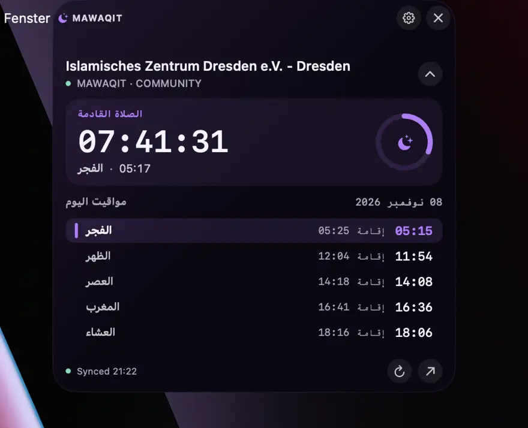
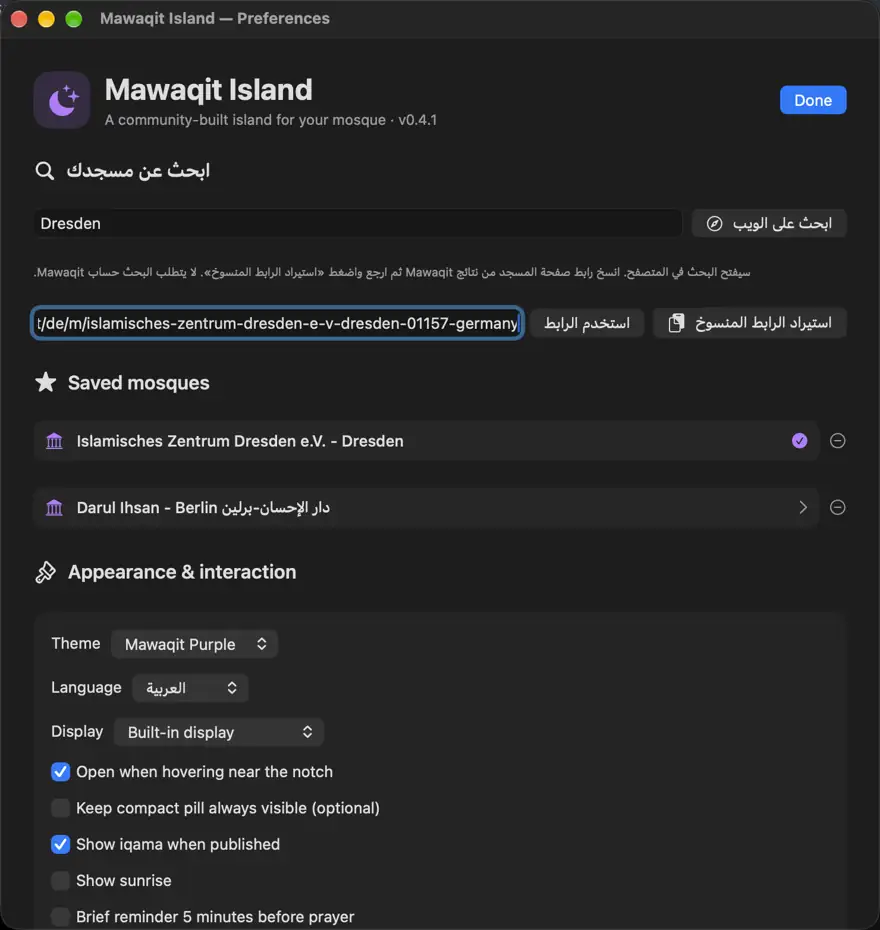

# 🌙 Mawaqit Island

**جزيرة أنيقة لمواقيت الصلاة على أجهزة Mac.**  
**العربية:** هذه الصفحة · **Deutsch:** [README.de.md](README.de.md) · **English:** [README.md](README.md)

[⬇️ تحميل أحدث نسخة للماك](https://github.com/abderlahmanalhnedi/Mawaqit-Island/releases/latest)

تطبيق مجاني ومستقل يعرض **عدًّا تنازليًا مباشرًا** للصلاة القادمة، ومواقيت الصلوات الخمس والإقامة عند توفرها، مع إمكانية اختيار المسجد. الجزيرة تظهر عند الاقتراب من أعلى الشاشة وتختفي تلقائيًا. لا يحتاج إلى SuperIsland أو حساب أو اشتراك.

## التثبيت — بدون Terminal

1. افتح صفحة [**Releases**](https://github.com/abderlahmanalhnedi/Mawaqit-Island/releases/latest).
2. حمّل **`Mawaqit-Island-macOS-universal.dmg`** (ابتداءً من v0.4.2). الإصدارات السابقة تتوفر كملف ZIP.
3. افتح DMG واسحب **Mawaqit Island.app** إلى **Applications**. في حالة ZIP، فك الضغط وانقل التطبيق إلى Applications.
4. افتح التطبيق من Applications، اختر مسجدك، وحرّك المؤشر إلى أعلى منتصف الشاشة.

**تحذير macOS:** ملف DMG لا يلغي تحذير Apple. التطبيق المجتمعي غير موثّق من Apple، لذلك إذا منع macOS فتحه، وبعد التأكد من أنك حملته من المشروع الصحيح، افتح **System Settings → Privacy & Security → Open Anyway** وأكد التشغيل. لا تعطل Gatekeeper بالكامل.

**التشغيل التلقائي:** افتح **Preferences → Appearance & interaction** وفعّل **Launch at login**. سيعمل التطبيق تلقائيًا بعد تسجيل الدخول إلى الماك عند تشغيله من جديد. الخيار معطل افتراضيًا ويمكن إيقافه لاحقًا.

**المتطلبات:** macOS 13+ مع Intel أو Apple Silicon. لا يحتاج تثبيت DMG إلى Terminal.

## المميزات

- ⏳ عدّ تنازلي يتحدث كل ثانية، وأوقات الصلاة والإقامة عند توفرها
- 🕌 اختيار أي مسجد عبر رابط صفحته العامة على MAWAQIT وحفظ المساجد المفضلة
- ✨ جزيرة صغيرة تختفي تلقائيًا وتتوسع عند الاقتراب
- 🎨 البنفسجي والأزرق الداكن والأسود؛ العربية والألمانية والإنجليزية
- ⚙️ خيارات للشروق والتذكير والشاشات وحجم الجزيرة
- 🔒 حفظ محلي، بدون تسجيل أو خدمة تتبع

## اختيار المسجد

اضغط أيقونة الهلال في شريط القوائم ثم **Preferences**. اختر **ابحث على الويب**، وانسخ رابط المسجد من MAWAQIT، ثم اضغط **استيراد الرابط المنسوخ**. أو الصق الرابط مباشرة واضغط **استخدم الرابط**.

## صور التطبيق

| جزيرة مواقيت الصلاة | الإعدادات واختيار المسجد |
|---|---|
|  |  |

[معرض الصور بالعربية والإنجليزية والألمانية](docs/SCREENSHOTS.md).

## للمطورين

لبناء التطبيق من المصدر على الماك بعد تثبيت أدوات Apple Command Line Tools:

```bash
bash install.command
```

[سجل التغييرات](CHANGELOG.md) · [المساهمة](CONTRIBUTING.md) · [الترخيص](LICENSE)

**تنويه:** مشروع مجتمعي غير رسمي، لا يتبع MAWAQIT أو Apple أو SuperIsland. يعتمد على البيانات العامة المنشورة في موقع MAWAQIT وقد تتغير آلية الوصول إليها. تأكد من المواقيت مع مسجدك عند الحاجة.
