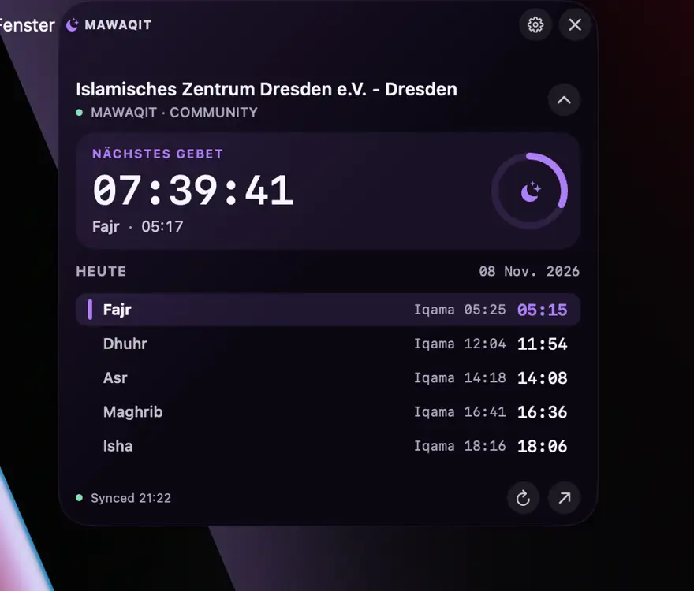
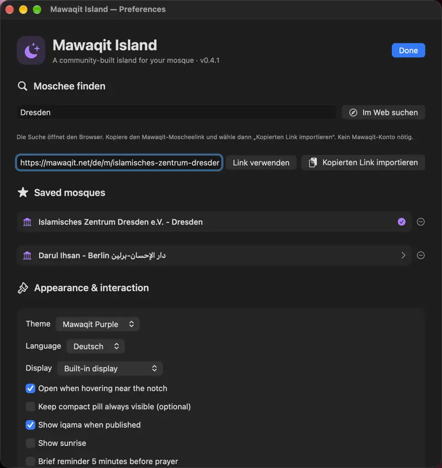

# 🌙 Mawaqit Island

**Gebetszeiten als elegante Dynamic-Island-ähnliche Anzeige für macOS.**  
**Deutsch:** diese Seite · **English:** [README.md](README.md) · **العربية:** [README.ar.md](README.ar.md)

[⬇️ Aktuelle macOS-Version herunterladen](https://github.com/abderlahmanalhnedi/Mawaqit-Island/releases/latest)

Mawaqit Island ist eine kostenlose, unabhängige Mac-App mit **Live-Countdown** bis zum nächsten Gebet, Gebets- und Iqama-Zeiten sowie auswählbarer Moschee. Die Insel verschwindet automatisch, wenn du sie nicht brauchst. Kein SuperIsland, Konto oder Abo nötig.

## Installation – ohne Terminal

1. Öffne [**Releases**](https://github.com/abderlahmanalhnedi/Mawaqit-Island/releases/latest).
2. Lade **`Mawaqit-Island-macOS-universal.dmg`** herunter (ab v0.4.2). Falls noch kein DMG vorhanden ist, nimm die **ZIP**.
3. Öffne die DMG und ziehe **Mawaqit Island.app** auf den Ordner **Applications** (bei ZIP: entpacken und nach **Programme** kopieren).
4. Starte die App aus **Programme**, wähle deine Moschee und bewege die Maus zur oberen Bildschirmmitte.

**Wichtig beim ersten Start:** Die Community-Version ist **nicht von Apple notarisiert**. Falls macOS die App blockiert, versuche sie einmal zu öffnen und gehe anschließend zu **Systemeinstellungen → Datenschutz & Sicherheit → Dennoch öffnen**. Bestätige den Dialog. Nur fortfahren, wenn du die Datei aus dem offiziellen Repository geladen und geprüft hast. Den Gatekeeper bitte **nicht global deaktivieren**.

**Voraussetzungen:** macOS 13 oder neuer · Intel und Apple Silicon · mit oder ohne Notch.

## Automatisch nach dem Anmelden starten

In **Preferences → Appearance & interaction** die Option **„Beim Anmelden starten“** aktivieren. Die App startet dann nach dem nächsten Login automatisch (nicht vor der Benutzeranmeldung). Diese Option ist standardmäßig deaktiviert und kann jederzeit in den macOS-Anmeldeobjekten geändert werden.

## Funktionen

- ⏳ Sekündlicher Countdown, fünf Gebetszeiten und – sofern verfügbar – Iqama
- 🕌 Moscheen über öffentliche MAWAQIT-Links auswählen und als Favoriten speichern
- ✨ Automatisch ein-/ausblendbare Insel mit Hover-Animation
- 🎨 Lila, Dunkelblau und Schwarz; Deutsch, Englisch und Arabisch
- ⚙️ Optional Sonnenaufgang, Erinnerungen, Monitorauswahl und Größenanpassung
- 🔒 Lokale Speicherung, keine Registrierung und kein Tracking-Dienst

## Moschee auswählen

Auf das Mondsymbol in der Menüleiste → **Preferences** klicken. Mit **Im Web suchen** eine Moschee finden, ihre öffentliche MAWAQIT-URL kopieren und **Kopierten Link importieren** wählen. Alternativ den Link direkt einfügen und **Link verwenden** drücken.

## Screenshots

| Gebetszeiten-Insel | Einstellungen |
|---|---|
|  |  |

[Alle Screenshots auf Deutsch, Englisch und Arabisch](docs/SCREENSHOTS.md).

## Für Entwickler

Mit installierten Apple Command Line Tools lässt sich die App aus dem Quellcode erstellen:

```bash
bash install.command
```

[Changelog](CHANGELOG.md) · [Mitwirken](CONTRIBUTING.md) · [Lizenz](LICENSE)

**Hinweis:** Inoffizielles Community-Projekt ohne Verbindung zu MAWAQIT, Apple oder SuperIsland. Die verwendeten öffentlichen MAWAQIT-Daten können sich ändern. Gebetszeiten bei Bedarf direkt mit der Moschee abgleichen.
