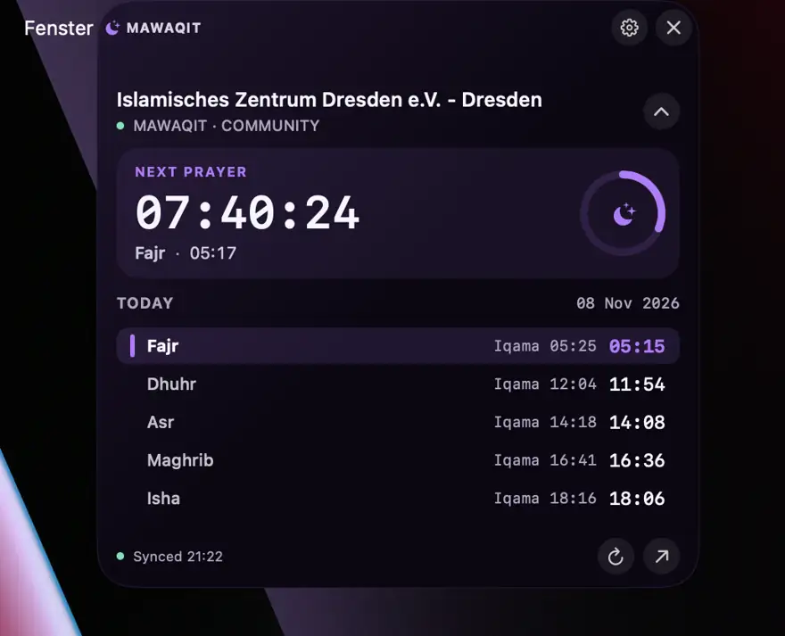
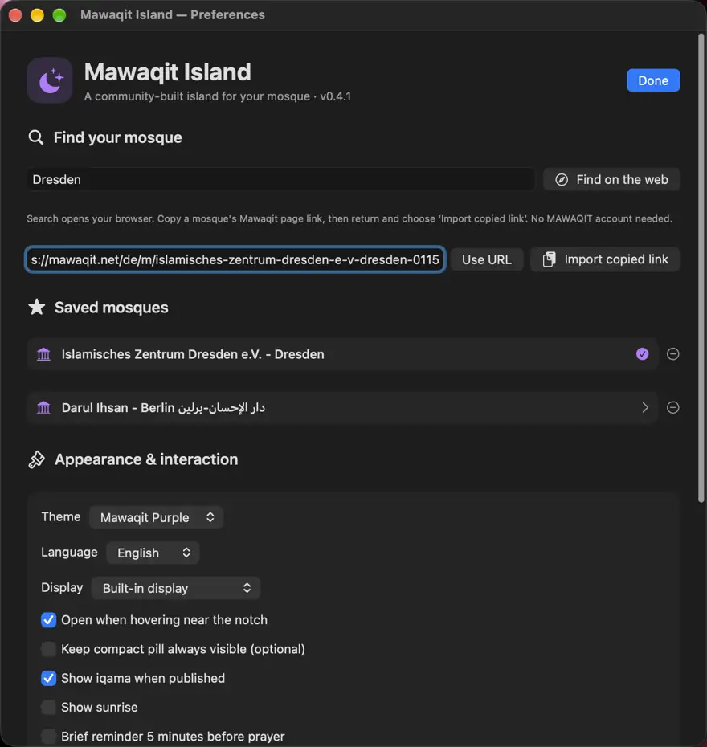

# 🌙 Mawaqit Island

**Prayer times in a beautiful Dynamic Island–style app for macOS.**  
**Deutsch:** [README.de.md](README.de.md) · **العربية:** [README.ar.md](README.ar.md) · **English:** this page

[⬇️ Download the latest macOS release](https://github.com/abderlahmanalhnedi/Mawaqit-Island/releases/latest)

Mawaqit Island is a free, independent macOS app that displays the next prayer, a **live countdown**, today's prayer and iqama times, and your chosen mosque. It hides near the notch when not needed. No SuperIsland, account, GPS, or subscription required.

## Install — no Terminal required

1. Open [**Releases**](https://github.com/abderlahmanalhnedi/Mawaqit-Island/releases/latest).
2. Download **`Mawaqit-Island-macOS-universal.dmg`** (from v0.4.2). For previous versions, download the **ZIP**.
3. Open the DMG and drag **Mawaqit Island.app** onto **Applications**. For the ZIP, unzip and copy the app into **Applications**.
4. Open the app from Applications, choose a mosque and hover at the top center of the screen.

**Security on first launch:** This community build is ad-hoc signed and **not notarized by Apple**. A DMG does not remove the Gatekeeper warning. If macOS blocks the app, after verifying the official download, open **System Settings → Privacy & Security → Open Anyway** and confirm. Do not turn off Gatekeeper globally.

**Launch automatically after restart:** In **Preferences → Appearance & interaction**, turn on **Launch at login**. The app opens after you log in to macOS. It is **off by default** and can be disabled at any time.

**Requirements:** macOS 13 or later · Intel and Apple Silicon · notch optional. No Terminal required to install the DMG.

## What it does

- ⏳ Real-time countdown to the next prayer; five daily prayers and available iqama times
- 🕌 Save and switch between multiple mosques using their public MAWAQIT page URL
- ✨ Compact, auto-hiding notch-style design; hover to expand, move away to hide
- 🎨 Purple, Midnight Blue and Pure Black themes; Arabic, German and English
- ⚙️ Optional sunrise, reminder, display selection, size and animation timings
- 🔒 Local preferences and cache; no registration or tracking service

## Choose your mosque

Open the moon icon in the menu bar → **Preferences**. Choose **Find on the web** and search for a mosque, copy its MAWAQIT public page URL, then select **Import copied link**. You can also paste the URL and use **Use URL**. The website's private search API is **not** used.

## Screenshots

| Island · live countdown | Preferences · choose your mosque |
|---|---|
|  |  |

[All screenshots in Arabic, English and German](docs/SCREENSHOTS.md).

## For developers

To build locally from source (requires Apple Command Line Tools):

```bash
bash install.command
```

The script builds and installs to `~/Applications/Mawaqit Island.app`. [Build instructions](docs/GITHUB_UPLOAD.md) · [Contributing](CONTRIBUTING.md) · [Changelog](CHANGELOG.md).

## Disclaimer

Independent community project, **not affiliated with or endorsed by MAWAQIT, Apple or SuperIsland**. Prayer data comes from public MAWAQIT mosque pages through an **unofficial integration** that may change. Check times against your mosque. MIT license.
