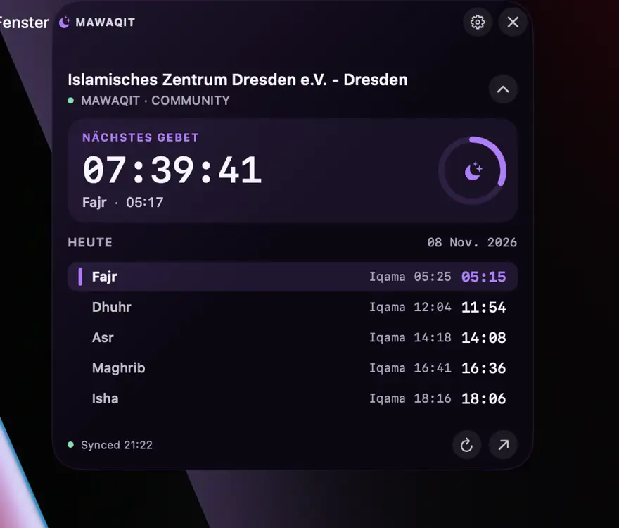
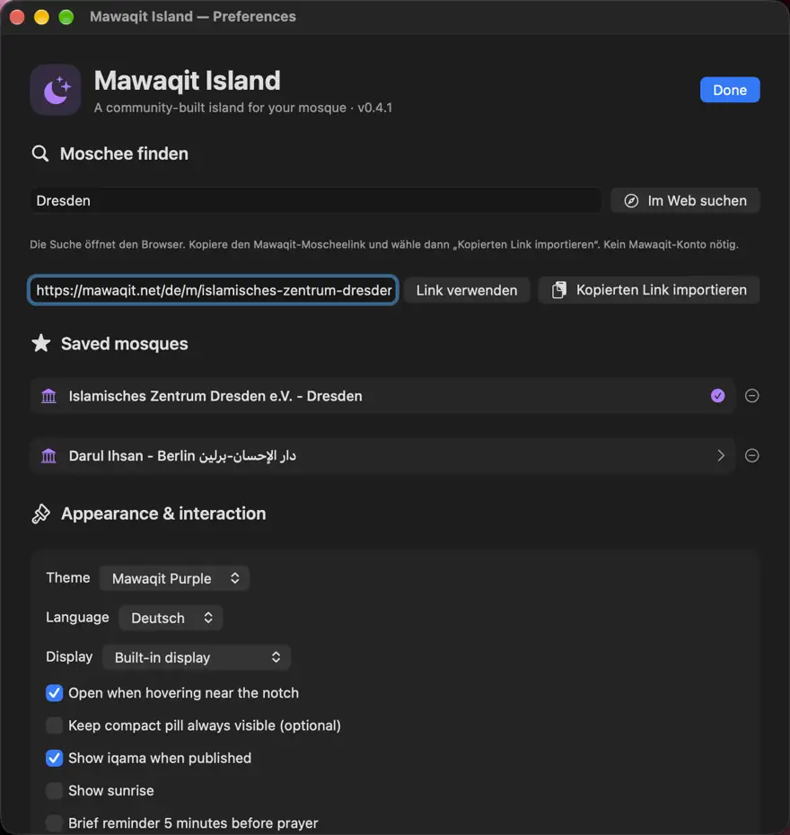
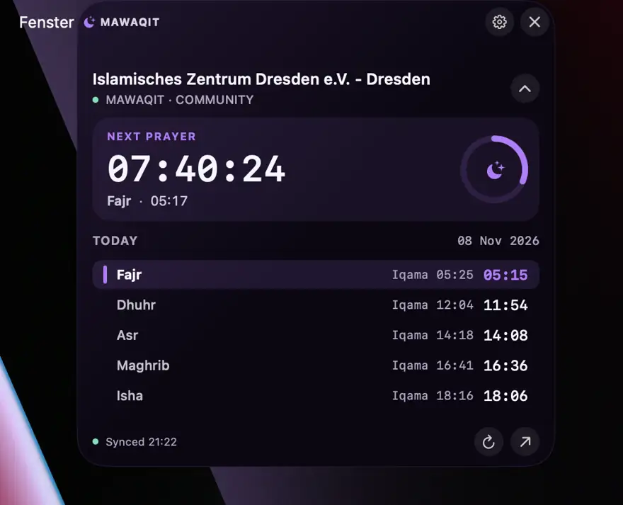
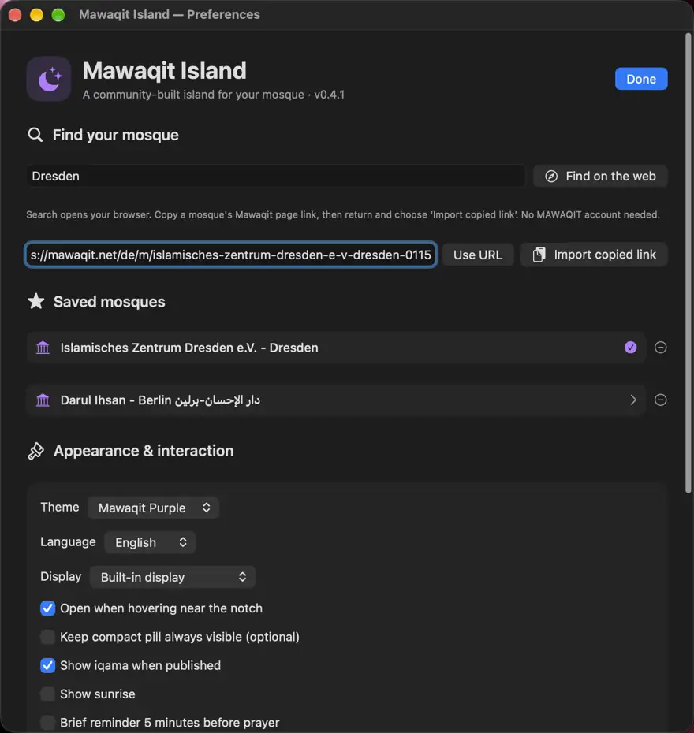
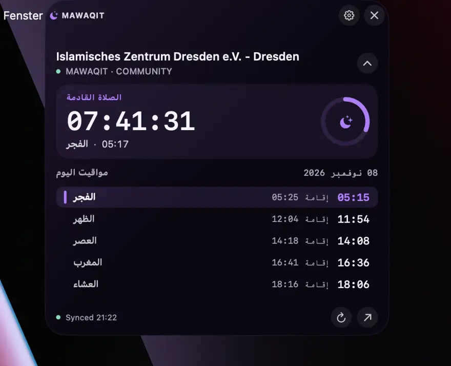
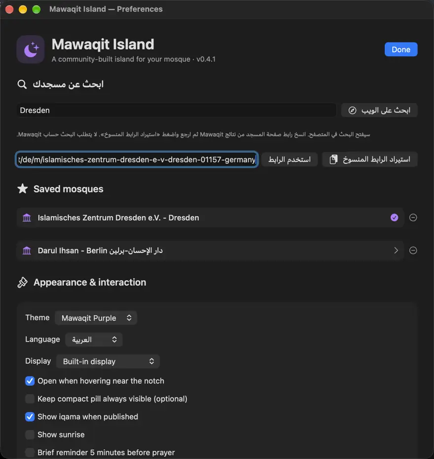

# 🌙 Mawaqit Island — Screenshots / Bilder / صور التطبيق

Actual screenshots of **Mawaqit Island v0.4.1** captured on a Mac, 8 November 2026. Times are from the author's configured mosque; the app displays the times for each user's chosen mosque.

## 🇩🇪 Deutsch
| Insel | Einstellungen |
|---|---|
|  |  |

## 🇬🇧 English
| Island | Preferences |
|---|---|
|  |  |

## 🇸🇦 العربية
| الجزيرة | الإعدادات |
|---|---|
|  |  |

Screenshots are supplied by the project owner, resized and exported as optimized WebP. No stock photographs are used.

[⬇️ Download for macOS](https://github.com/abderlahmanalhnedi/Mawaqit-Island/releases/latest) · [README English](../README.md) · [Deutsch](../README.de.md) · [العربية](../README.ar.md)
